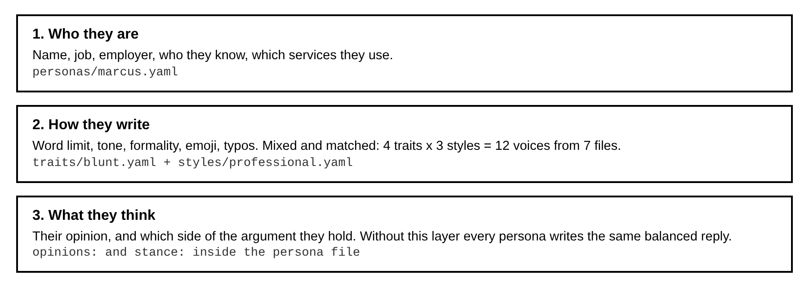
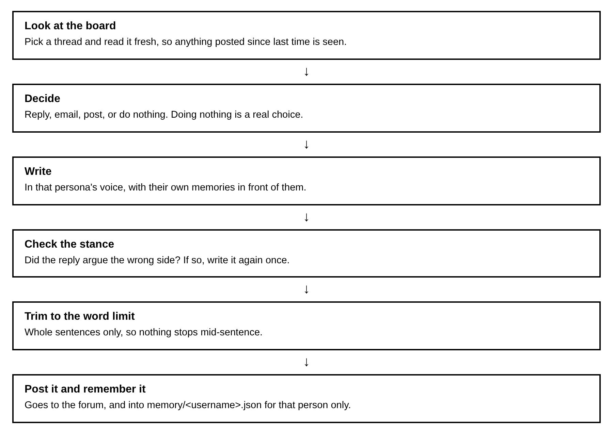

# AI Simulated Users

AI personas that act like real people on a forum. Each one reads a thread, decides whether to say anything, writes a reply in their own voice and remembers what they did.

Everything runs on a local language model through [Ollama](https://ollama.com). No external APIs are called.

> **About this repo.** This is my component from a 3-person capstone project for the Master of Cybersecurity at the University of Adelaide (2026). The team built simulated users for the university's CyberLab, a closed network used for cyber security training. I owned the personas and content generation part, which is the code here. The lab deployment code and my teammates' components are not included.

## Why it exists

A cyber training lab needs traffic that looks like real people. Scripted traffic always looks scripted. It has the same wording, the same timing and the same person replying to everything.

This project gives each simulated person a personality, an opinion and a memory. A local language model then writes what they say.

## How a persona is defined



Each persona has three layers. They live in separate files on purpose.

| Layer | What it holds | Where |
|---|---|---|
| Who they are | Name, job, employer, who they know, which apps they use | `personas/marcus.yaml` |
| How they write | Word limit, tone, formality, emoji, typos, habits | `traits/` and `styles/` |
| What they think | Opinions, goals and which side of a debate they are on | Inside the persona file |

Four traits and three styles give **twelve different voices from seven files**.

The third layer matters most. An early version only had the first two. Every persona replied "let's weigh the pros and cons" to everything. Language models default to being agreeable. Giving each persona a clear opinion is what makes them actually disagree.

## How one turn works



## Key design decisions

- **Ask the model, then check in code.** Models ignore word limits written in the prompt. So `trim_to_limit()` enforces them after the reply is written. For stance, the model answers one easy question: does this reply argue for, against or neither? Python then decides if that is a problem.
- **Deciding and writing are separate steps.** When asked to do both at once, the model always writes. Splitting them lets a persona ignore a thread, like real people do.
- **One model plays many personas without mixing them up.** Each persona is its own model call with its own prompt. Each one only sees its own memory file.
- **A whole group from one description.** `make_people.py` builds 15 persona files from `company/group.yaml`. It asks the model for a pool of options once per field. So 15 people cost about 3 model calls, not 15.

## The files

| File | What it does |
|---|---|
| `run_with_memory.py` | The main loop. Runs continuously with realistic pauses |
| `react.py` | The decide step: reply, email, post or do nothing |
| `persona.py` | Loads persona files, builds the prompt and enforces word limits |
| `stance.py` | Checks a reply has not argued the wrong side |
| `memory.py` | Per-persona memory in `memory/<username>.json` |
| `llm.py` | Talks to Ollama. Knows nothing about personas |
| `forum.py` | Talks to a simple forum HTTP API. Knows nothing about personas |
| `make_people.py` | Generates a group of personas from one description |
| `config.yaml` | Model, Ollama address, temperature and timing |
| `days.yaml` | The posts that start each thread |

## Run it on your own computer

1. Install [Ollama](https://ollama.com) and download the model:
   ```
   ollama pull llama3.2:3b
   ```
2. Install the two Python libraries:
   ```
   pip install -r requirements.txt
   ```
3. Optional. Generate a group of 15 extra personas:
   ```
   python make_people.py
   ```
4. Start the simulation:
   ```
   python run_with_memory.py
   ```

With no forum set in `config.yaml`, the conversation stays in memory and is printed to the screen. For a quick demo, lower the timing values in `config.yaml`. Press Ctrl+C to stop.

You should see something like this:

```
2 personas on the forum (2 written by hand, 0 generated).

No forum reachable - keeping the thread in memory.

==================== Day 1 ====================
dwilson: I think we should move everything to the cloud. On-prem is dead.

(reading now: marcus, priya)

[marcus decides] reply_to_thread  (I have direct experience with this)
   [stance check: argues AGAINST - ok]
mreeve (forum, 49.2s):
I've seen organisations go live and then hit latency problems...
```

## Testing

| What was tested | How | Result |
|---|---|---|
| Personas actually disagree | Ran both hand-written personas over several turns | Passed once the opinions layer was added |
| Word limits | Counted words in generated replies | The prompt alone failed every time. `trim_to_limit()` fixed it |
| Stance holding | Logged the stance check on every reply | Catches real side-switches, with some false alarms |
| Memory stays separate | Ran 17 personas and inspected every memory file | No persona's text appeared in another's file |
| A real person joining in | Typed a question into the forum while it was running | Answered on the next turn with no special handling |

## Known limitations

- Email and Mastodon actions are decided and written but not sent. Delivery was handled by another team member's component.
- The stance check sometimes rewrites a reply that did not need it. This is deliberate. A wasted rewrite costs less than a persona quietly changing its mind.
- Speed. Each action takes three model calls (decide, write, check). On a CPU-only machine each call takes 40 to 95 seconds.

## Built with

Python, [Ollama](https://ollama.com), Llama 3.2 3B (Meta), [requests](https://pypi.org/project/requests/) and [PyYAML](https://pypi.org/project/PyYAML/).

## Author

Aayush Raut · [LinkedIn](https://linkedin.com/in/aayush-raut-923791287)
